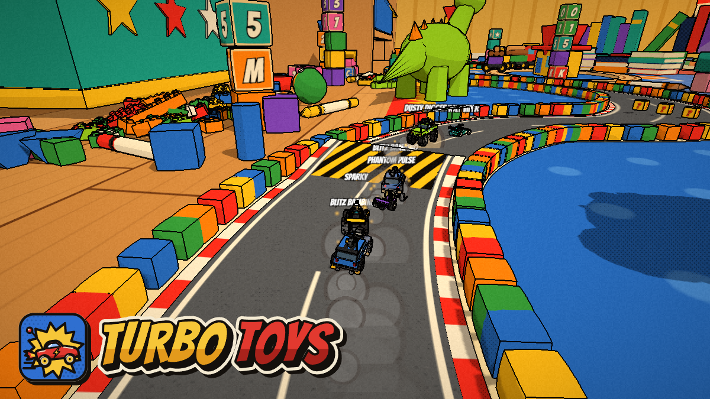

<div align="center">


# TurboToys

**Ferngesteuert. Frisiert. Furchtlos.**

Ferngesteuerte Spielzeugautos rasen im Comic-Look durch Kinderzimmer, Garten, Küche, Werkstatt, Supermarkt und Dachboden –
mit Elektro-, Benzin- und Turbo-Antrieb, Waffen aus Kisten, Tuning, Pokalen und Online-Rennen.

</div>



---

## Das Spiel

- 🏎️ **Acht Autos** – Buggy, Monstertruck, Muscle-Car, Rallye, Supersportler, Lieferwagen, Formel, Pickup. **Elektro** zieht sofort los, **Benzin** brüllt und dreht hoch, **Turbo** ist erst träge und kickt dann.
- 🔥 **Turbo-Mechanik** – Shift zündet den Turbo-Tank. Er lädt beim Driften, auf Turbo-Pfeilen und aus Kisten.
- 💥 **Waffen** – Bord-MG für alle, aus den „?“-Kisten Feuerwerksraketen, Reißzwecken-Minen, Ölpfützen, Batterie-Schock und Gummischild. Wer schrottet, kassiert Kopfgeld.
- 🔧 **Garage** – mit Preisgeld („Schrauben“) neue Autos kaufen und Motor, Reifen, Panzerung, Turbo und Waffen tunen; Lack, Aufkleber und Startnummer.
- 🏆 **Pokale** – mehrere Rennen gegen dieselben Gegner, Punkte pro Platz, Preisgeld für die Besten.
- 👤 **Profil** – Comic-Avatar (Gesicht, Frisur, Helm …), Level mit Freischaltungen, Statistik und Rangliste.
- 🌍 **Sechs detailreiche Welten** bei Tag, Abend oder Nacht – mit Sprungschanzen, Rampen und erhöhten Abschnitten.
- 🎨 **Comic-Look wie im Heft** – Tusche-Konturen, Rasterpunkte, Lautmalerei („KAWUMM!“, „ZOOM!“) und Comic-Panels, die Unfälle im Bild zeigen.
- 🌐 **Mehrspieler** – Räume mit Code und Einladungslink, mit oder ohne Bots. Offline in der App gegen Bots.

**Steuerung:** W/S Gas/Bremse · A/D lenken · Leertaste Handbremse · Shift Turbo · Strg MG · E Waffe · C Kamera · B nach hinten · R zurück auf die Strecke · Esc Pause.
Gamepad: RT/LT, Stick, A Turbo, B Handbremse, X MG, Y Waffe.

## So läuft es

TurboToys ist ein **Spiel von [MatGame](https://github.com/Real-TTX/MatGame)** – dem Server der Mat-Spiele mit Portal, Konten, Gästen und Administration.

| Weg | Adresse | Was |
|---|---|---|
| **MatGame** (alle Spiele) | `http://<server>:2770/turbotoys/` | das Image `ghcr.io/real-ttx/matgame` |
| **TurboToys allein** | `http://<server>:2773/turbotoys/` | das Image `ghcr.io/real-ttx/turbotoys` (MatGame-Server nur mit TurboToys) – z. B. für die LAN-Party |
| **Windows-App** | `TurboToys.exe` aus den Releases | online gegen einen Server oder **offline** gegen Bots |

```bash
docker compose up -d                              # Release (:latest)  → http://localhost:2773/turbotoys/
docker compose -f docker-compose.dev.yml up -d    # Nightly (:nightly)
docker compose -f docker-compose.local.yml up -d --build   # selbst gebaut (braucht ../MatGame), mit pgAdmin auf 2776
```

Das **erste Konto**, das sich registriert, ist Administrator. Die Verwaltung liegt unter **/Admin → TurboToys**:
Übersicht, Spieler (Geld, XP, Garage), Rennen, Autos, Strecken, Pokale, Waffen, Einstellungen.

| Datei | Kanal | Image |
|---|---|---|
| `docker-compose.yml` | Release (Branch `main`) | `ghcr.io/real-ttx/turbotoys:latest` |
| `docker-compose.dev.yml` | Nightly (Branch `dev`) | `ghcr.io/real-ttx/turbotoys:nightly` |
| `docker-compose.local.yml` | lokal gebaut | `turbotoys:local` |

Versionen: Release `<major>.<minor>.<build>-<datum>`, Nightly `nightly-<build>-<datum>`, lokal `local-<datum>`.

## Entwickeln

Alle Repos liegen nebeneinander: `Development/MatGame`, `Development/TurboToys` (und die anderen Spiele).

```powershell
./scripts/redeploy.ps1                  # MatGame-Stack mit allen Spielen neu bauen → http://localhost:2770/turbotoys/
dotnet build TurboToys.slnx
dotnet test TurboToys.slnx
node scripts/serve.mjs 2779             # Vorschauen ohne Server: /turbotoys/dev/world.html, cars.html, sound-avatar.html
```

Mehr in [CLAUDE.md](CLAUDE.md) (Aufbau, Regeln) und [docs/PROTOCOL.md](docs/PROTOCOL.md) (API, Hub, offline).

## Lizenz

© Matthias Schmoldt. Alle Rechte vorbehalten. Schriften: Bangers, Permanent Marker, Nunito (SIL Open Font License, siehe `wwwroot/fonts`). three.js und SignalR: MIT.
